# Galeria — Chapéu Minúsculo

Status: em desenvolvimento.

60 variantes de traje. Em cada linha: neutro original, neutro com chapéu, feliz, triste, raiva e confuso. As miniaturas usam um fundo de papel para inspeção; os PNGs de entrega têm transparência real.

O chapéu usa copa e aba quase pretas, com faixa e borda claras para se separar do cabelo. As cinco expressões, os figurinos e os acessórios seguem os bustos originais. [Método, fontes e integração](README.md).

## Sevrak

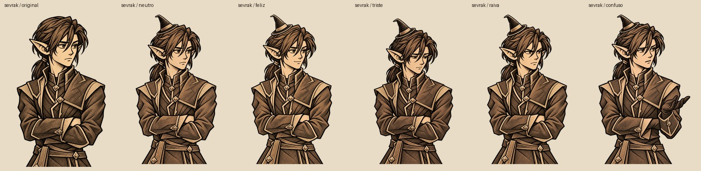

[Ficha](../../../personagens/sevrak.md) · [Referência neutra](../../../../../assets/terminus/bustos/expressoes/sevrak/neutro.png) · [PNG de entrega](../../../../../assets/terminus/bustos/expressoes/sevrak/tiny-hat/)

[neutro — prompt e verificação](registros/sevrak-neutro.json) · [feliz — prompt e verificação](registros/sevrak-feliz.json) · [triste — prompt e verificação](registros/sevrak-triste.json) · [raiva — prompt e verificação](registros/sevrak-raiva.json) · [confuso — prompt e verificação](registros/sevrak-confuso.json)

## Ghork

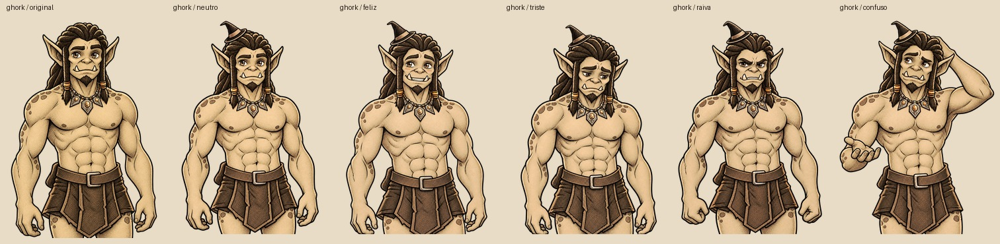

[Ficha](../../../personagens/ghork.md) · [Referência neutra](../../../../../assets/terminus/bustos/expressoes/ghork/neutro.png) · [PNG de entrega](../../../../../assets/terminus/bustos/expressoes/ghork/tiny-hat/)

[neutro — prompt e verificação](registros/ghork-neutro.json) · [feliz — prompt e verificação](registros/ghork-feliz.json) · [triste — prompt e verificação](registros/ghork-triste.json) · [raiva — prompt e verificação](registros/ghork-raiva.json) · [confuso — prompt e verificação](registros/ghork-confuso.json)

## Brakka

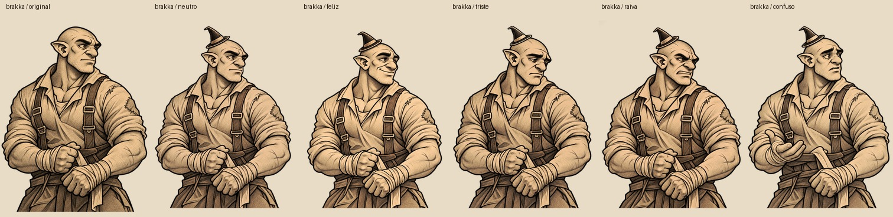

[Ficha](../../../personagens/brakka.md) · [Referência neutra](../../../../../assets/terminus/bustos/expressoes/brakka/neutro.png) · [PNG de entrega](../../../../../assets/terminus/bustos/expressoes/brakka/tiny-hat/)

[neutro — prompt e verificação](registros/brakka-neutro.json) · [feliz — prompt e verificação](registros/brakka-feliz.json) · [triste — prompt e verificação](registros/brakka-triste.json) · [raiva — prompt e verificação](registros/brakka-raiva.json) · [confuso — prompt e verificação](registros/brakka-confuso.json)

## Nima

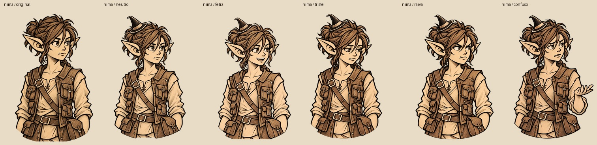

[Ficha](../../../personagens/nima.md) · [Referência neutra](../../../../../assets/terminus/bustos/expressoes/nima/neutro.png) · [PNG de entrega](../../../../../assets/terminus/bustos/expressoes/nima/tiny-hat/)

[neutro — prompt e verificação](registros/nima-neutro.json) · [feliz — prompt e verificação](registros/nima-feliz.json) · [triste — prompt e verificação](registros/nima-triste.json) · [raiva — prompt e verificação](registros/nima-raiva.json) · [confuso — prompt e verificação](registros/nima-confuso.json)

## Sura

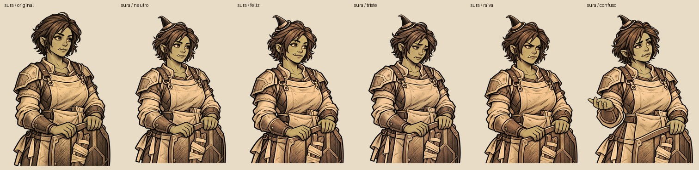

[Ficha](../../../personagens/sura.md) · [Referência neutra](../../../../../assets/terminus/bustos/expressoes/sura/neutro.png) · [PNG de entrega](../../../../../assets/terminus/bustos/expressoes/sura/tiny-hat/)

[neutro — prompt e verificação](registros/sura-neutro.json) · [feliz — prompt e verificação](registros/sura-feliz.json) · [triste — prompt e verificação](registros/sura-triste.json) · [raiva — prompt e verificação](registros/sura-raiva.json) · [confuso — prompt e verificação](registros/sura-confuso.json)

## Edrin

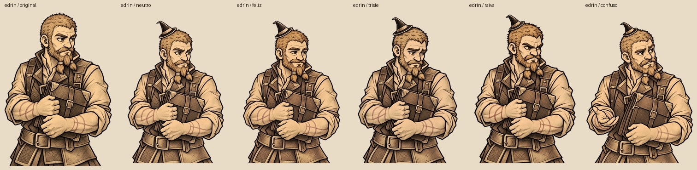

[Ficha](../../../personagens/edrin.md) · [Referência neutra](../../../../../assets/terminus/bustos/expressoes/edrin/neutro.png) · [PNG de entrega](../../../../../assets/terminus/bustos/expressoes/edrin/tiny-hat/)

[neutro — prompt e verificação](registros/edrin-neutro.json) · [feliz — prompt e verificação](registros/edrin-feliz.json) · [triste — prompt e verificação](registros/edrin-triste.json) · [raiva — prompt e verificação](registros/edrin-raiva.json) · [confuso — prompt e verificação](registros/edrin-confuso.json)

## Korr

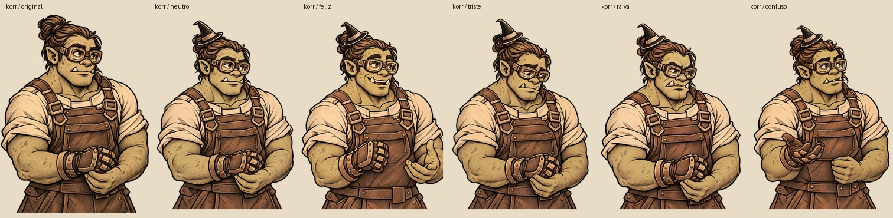

[Ficha](../../../personagens/korr.md) · [Referência neutra](../../../../../assets/terminus/bustos/expressoes/korr/neutro.png) · [PNG de entrega](../../../../../assets/terminus/bustos/expressoes/korr/tiny-hat/)

[neutro — prompt e verificação](registros/korr-neutro.json) · [feliz — prompt e verificação](registros/korr-feliz.json) · [triste — prompt e verificação](registros/korr-triste.json) · [raiva — prompt e verificação](registros/korr-raiva.json) · [confuso — prompt e verificação](registros/korr-confuso.json)

## Velka

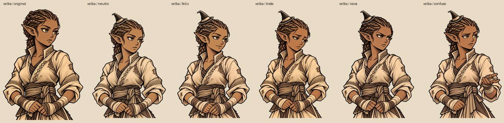

[Ficha](../../../personagens/velka.md) · [Referência neutra](../../../../../assets/terminus/bustos/expressoes/velka/neutro.png) · [PNG de entrega](../../../../../assets/terminus/bustos/expressoes/velka/tiny-hat/)

[neutro — prompt e verificação](registros/velka-neutro.json) · [feliz — prompt e verificação](registros/velka-feliz.json) · [triste — prompt e verificação](registros/velka-triste.json) · [raiva — prompt e verificação](registros/velka-raiva.json) · [confuso — prompt e verificação](registros/velka-confuso.json)

## Tessa

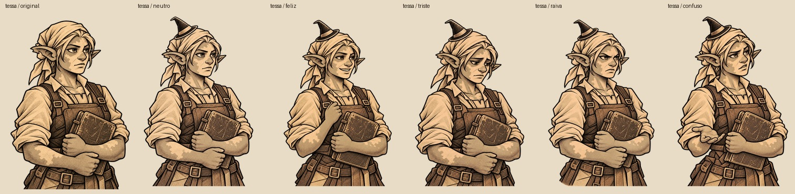

[Ficha](../../../personagens/tessa.md) · [Referência neutra](../../../../../assets/terminus/bustos/expressoes/tessa/neutro.png) · [PNG de entrega](../../../../../assets/terminus/bustos/expressoes/tessa/tiny-hat/)

[neutro — prompt e verificação](registros/tessa-neutro.json) · [feliz — prompt e verificação](registros/tessa-feliz.json) · [triste — prompt e verificação](registros/tessa-triste.json) · [raiva — prompt e verificação](registros/tessa-raiva.json) · [confuso — prompt e verificação](registros/tessa-confuso.json)

## Mavren

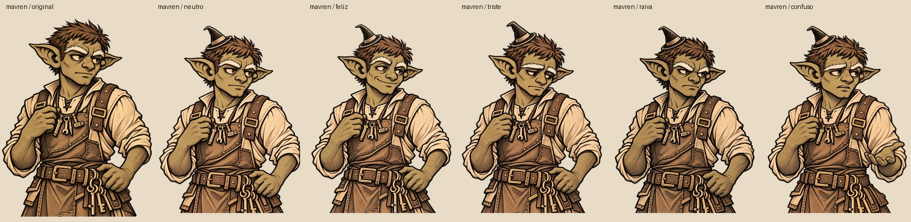

[Ficha](../../../personagens/mavren.md) · [Referência neutra](../../../../../assets/terminus/bustos/expressoes/mavren/neutro.png) · [PNG de entrega](../../../../../assets/terminus/bustos/expressoes/mavren/tiny-hat/)

[neutro — prompt e verificação](registros/mavren-neutro.json) · [feliz — prompt e verificação](registros/mavren-feliz.json) · [triste — prompt e verificação](registros/mavren-triste.json) · [raiva — prompt e verificação](registros/mavren-raiva.json) · [confuso — prompt e verificação](registros/mavren-confuso.json)

## Odrik

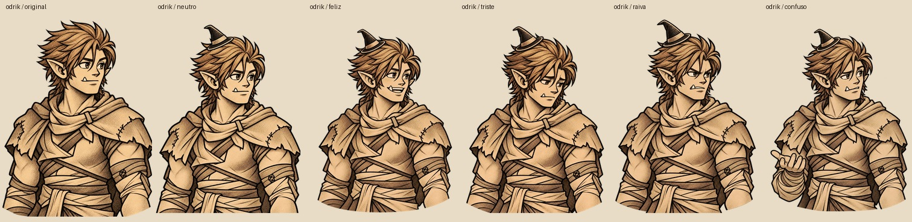

[Ficha](../../../personagens/odrik.md) · [Referência neutra](../../../../../assets/terminus/bustos/expressoes/odrik/neutro.png) · [PNG de entrega](../../../../../assets/terminus/bustos/expressoes/odrik/tiny-hat/)

[neutro — prompt e verificação](registros/odrik-neutro.json) · [feliz — prompt e verificação](registros/odrik-feliz.json) · [triste — prompt e verificação](registros/odrik-triste.json) · [raiva — prompt e verificação](registros/odrik-raiva.json) · [confuso — prompt e verificação](registros/odrik-confuso.json)

## Lethra

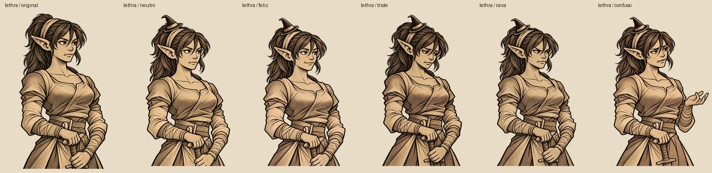

[Ficha](../../../personagens/lethra.md) · [Referência neutra](../../../../../assets/terminus/bustos/expressoes/lethra/neutro.png) · [PNG de entrega](../../../../../assets/terminus/bustos/expressoes/lethra/tiny-hat/)

[neutro — prompt e verificação](registros/lethra-neutro.json) · [feliz — prompt e verificação](registros/lethra-feliz.json) · [triste — prompt e verificação](registros/lethra-triste.json) · [raiva — prompt e verificação](registros/lethra-raiva.json) · [confuso — prompt e verificação](registros/lethra-confuso.json)
