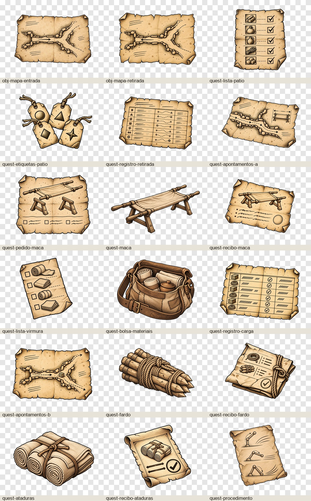
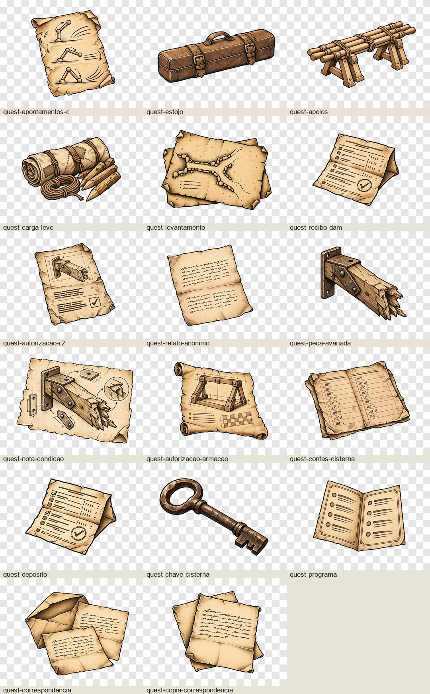

# Galeria dos objetos

Status: em desenvolvimento. Aprovação artística pendente.

35 objetos produzidos com `image_gen`, exportados em PNG RGBA 720 × 540 px e associados ao protótipo.

| Objeto | PNG final | Contexto | Cena conferida |
| --- | --- | --- | --- |
| Mapa — entrada pelo pátio | [obj-mapa-entrada](../../../../assets/terminus/objetos/obj-mapa-entrada.png) | Q-A2 · O caminho de volta; Q-B3 · Borun não veio; Q-C3 · Um método sem o mestre | [Captura](verificacao-browser/obj-mapa-entrada.png) |
| Mapa — percurso de retirada | [obj-mapa-retirada](../../../../assets/terminus/objetos/obj-mapa-retirada.png) | Q-A2 · O caminho de volta; Q-B3 · Borun não veio; Q-C3 · Um método sem o mestre | [Captura](verificacao-browser/obj-mapa-retirada.png) |
| Lista conferida do pátio | [quest-lista-patio](../../../../assets/terminus/objetos/quest-lista-patio.png) | R1 · Um pátio, dois planos | [Captura](verificacao-browser/quest-lista-patio.png) |
| Etiquetas dos volumes do despacho | [quest-etiquetas-patio](../../../../assets/terminus/objetos/quest-etiquetas-patio.png) | R1 · Um pátio, dois planos | [Captura](verificacao-browser/quest-etiquetas-patio.png) |
| Cópia anônima do registro de retirada | [quest-registro-retirada](../../../../assets/terminus/objetos/quest-registro-retirada.png) | Q-A2 · O caminho de volta | [Captura](verificacao-browser/quest-registro-retirada.png) |
| Apontamentos de Elune para Virmura | [quest-apontamentos-a](../../../../assets/terminus/objetos/quest-apontamentos-a.png) | Q-A2 · O caminho de volta | [Captura](verificacao-browser/quest-apontamentos-a.png) |
| Pedido de empréstimo de material | [quest-pedido-maca](../../../../assets/terminus/objetos/quest-pedido-maca.png) | Q-A3 · Alguém precisa ficar | [Captura](verificacao-browser/quest-pedido-maca.png) |
| Maca e suportes de demonstração | [quest-maca](../../../../assets/terminus/objetos/quest-maca.png) | Q-A3 · Alguém precisa ficar; Q-A4 · Uma maca na porta | [Captura](verificacao-browser/quest-maca.png) |
| Recibo do conjunto emprestado | [quest-recibo-maca](../../../../assets/terminus/objetos/quest-recibo-maca.png) | Q-A3 · Alguém precisa ficar | [Captura](verificacao-browser/quest-recibo-maca.png) |
| Lista de Virmura | [quest-lista-virmura](../../../../assets/terminus/objetos/quest-lista-virmura.png) | Q-B1 · O corredor errado | [Captura](verificacao-browser/quest-lista-virmura.png) |
| Bolsa de ataduras e material de lavagem | [quest-bolsa-materiais](../../../../assets/terminus/objetos/quest-bolsa-materiais.png) | Q-B1 · O corredor errado | [Captura](verificacao-browser/quest-bolsa-materiais.png) |
| Cópia autorizada de Pirka | [quest-registro-carga](../../../../assets/terminus/objetos/quest-registro-carga.png) | Q-B2 · Onde a carroça parou; Q-B3 · Borun não veio | [Captura](verificacao-browser/quest-registro-carga.png) |
| Apontamentos de Elune para Borun | [quest-apontamentos-b](../../../../assets/terminus/objetos/quest-apontamentos-b.png) | Q-B3 · Borun não veio | [Captura](verificacao-browser/quest-apontamentos-b.png) |
| Fardo de cordas e estacas | [quest-fardo](../../../../assets/terminus/objetos/quest-fardo.png) | Q-B4 · A carga não é de vocês | [Captura](verificacao-browser/quest-fardo.png) |
| Recibo da carga recuperada | [quest-recibo-fardo](../../../../assets/terminus/objetos/quest-recibo-fardo.png) | Q-B4 · A carga não é de vocês | [Captura](verificacao-browser/quest-recibo-fardo.png) |
| Pacote de ataduras | [quest-ataduras](../../../../assets/terminus/objetos/quest-ataduras.png) | Q-C1 · O movimento repetido | [Captura](verificacao-browser/quest-ataduras.png) |
| Confirmação de Rask | [quest-recibo-ataduras](../../../../assets/terminus/objetos/quest-recibo-ataduras.png) | Q-C1 · O movimento repetido | [Captura](verificacao-browser/quest-recibo-ataduras.png) |
| Cópia do procedimento | [quest-procedimento](../../../../assets/terminus/objetos/quest-procedimento.png) | Q-C2 · O que a régua não diz; Q-C3 · Um método sem o mestre | [Captura](verificacao-browser/quest-procedimento.png) |
| Procedimento revisado por Elune | [quest-apontamentos-c](../../../../assets/terminus/objetos/quest-apontamentos-c.png) | Q-C3 · Um método sem o mestre | [Captura](verificacao-browser/quest-apontamentos-c.png) |
| Estojo de treino restituído | [quest-estojo](../../../../assets/terminus/objetos/quest-estojo.png) | Q-C4 · Pode repetir na minha frente | [Captura](verificacao-browser/quest-estojo.png) |
| Apoios de retirada | [quest-apoios](../../../../assets/terminus/objetos/quest-apoios.png) | Q-X1 · Antes de entrar | [Captura](verificacao-browser/quest-apoios.png) |
| Carga leve e marcadores | [quest-carga-leve](../../../../assets/terminus/objetos/quest-carga-leve.png) | Q-Y1 · O peso de cada coisa | [Captura](verificacao-browser/quest-carga-leve.png) |
| Levantamento das galerias | [quest-levantamento](../../../../assets/terminus/objetos/quest-levantamento.png) | Q-X2 · Onde paramos; Q-Y2 · Onde paramos; Q-20 · Meu nome na lista | [Captura](verificacao-browser/quest-levantamento.png) |
| Cópia do registro da contribuição a Dam | [quest-recibo-dam](../../../../assets/terminus/objetos/quest-recibo-dam.png) | Q-20 · Meu nome na lista | [Captura](verificacao-browser/quest-recibo-dam.png) |
| Autorização para conferir a peça | [quest-autorizacao-r2](../../../../assets/terminus/objetos/quest-autorizacao-r2.png) | R2 · Quem põe o nome? | [Captura](verificacao-browser/quest-autorizacao-r2.png) |
| Cópia anônima do relato | [quest-relato-anonimo](../../../../assets/terminus/objetos/quest-relato-anonimo.png) | R2 · Quem põe o nome? | [Captura](verificacao-browser/quest-relato-anonimo.png) |
| Peça de treino avariada | [quest-peca-avariada](../../../../assets/terminus/objetos/quest-peca-avariada.png) | R2 · Quem põe o nome? | [Captura](verificacao-browser/quest-peca-avariada.png) |
| Nota de condição de Durn | [quest-nota-condicao](../../../../assets/terminus/objetos/quest-nota-condicao.png) | R2 · Quem põe o nome? | [Captura](verificacao-browser/quest-nota-condicao.png) |
| Autorização de apresentação da armação | [quest-autorizacao-armacao](../../../../assets/terminus/objetos/quest-autorizacao-armacao.png) | R3 · Antes de desmontar | [Captura](verificacao-browser/quest-autorizacao-armacao.png) |
| Cópia dos valores devidos | [quest-contas-cisterna](../../../../assets/terminus/objetos/quest-contas-cisterna.png) | R4 · A chave da cisterna | [Captura](verificacao-browser/quest-contas-cisterna.png) |
| Comprovante de depósito | [quest-deposito](../../../../assets/terminus/objetos/quest-deposito.png) | R4 · A chave da cisterna | [Captura](verificacao-browser/quest-deposito.png) |
| Chave da cisterna | [quest-chave-cisterna](../../../../assets/terminus/objetos/quest-chave-cisterna.png) | R4 · A chave da cisterna | [Captura](verificacao-browser/quest-chave-cisterna.png) |
| Programa da apresentação | [quest-programa](../../../../assets/terminus/objetos/quest-programa.png) | R5 · Uma vez diante do público | [Captura](verificacao-browser/quest-programa.png) |
| Correspondência do fornecedor | [quest-correspondencia](../../../../assets/terminus/objetos/quest-correspondencia.png) | Os registros nas caixas | [Captura](verificacao-browser/quest-correspondencia.png) |
| Cópia da correspondência preservada | [quest-copia-correspondencia](../../../../assets/terminus/objetos/quest-copia-correspondencia.png) | Os registros nas caixas | [Captura](verificacao-browser/quest-copia-correspondencia.png) |
