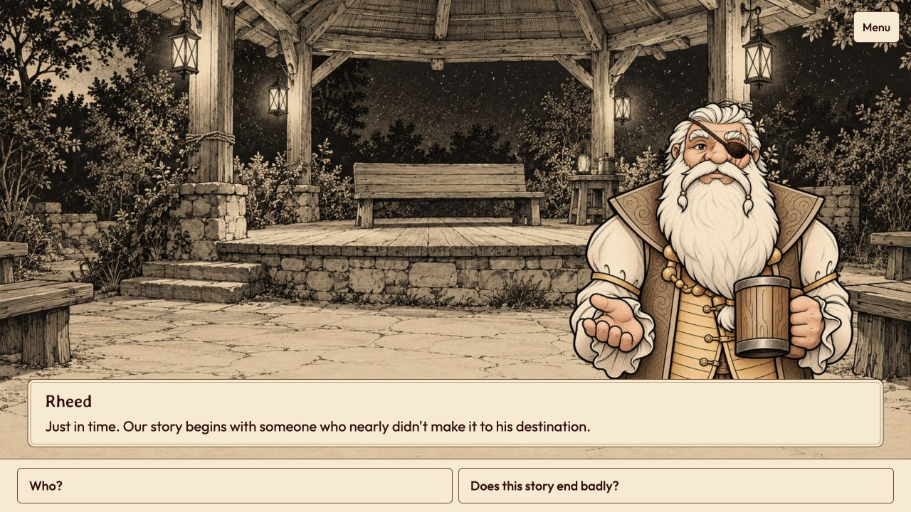
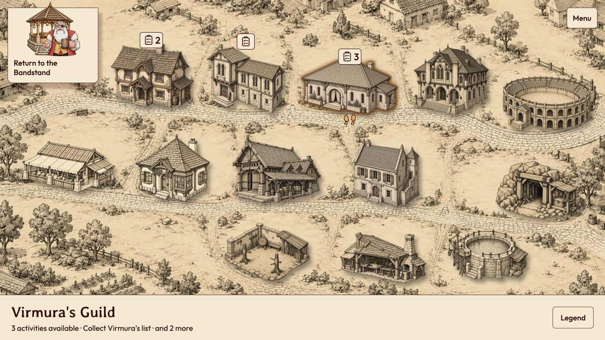
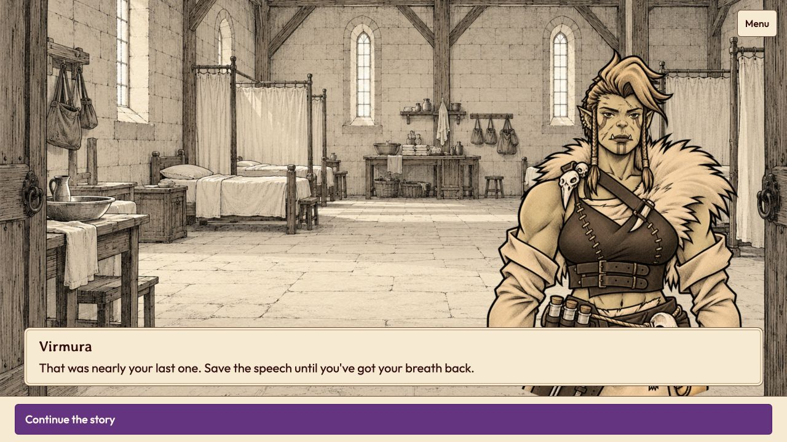
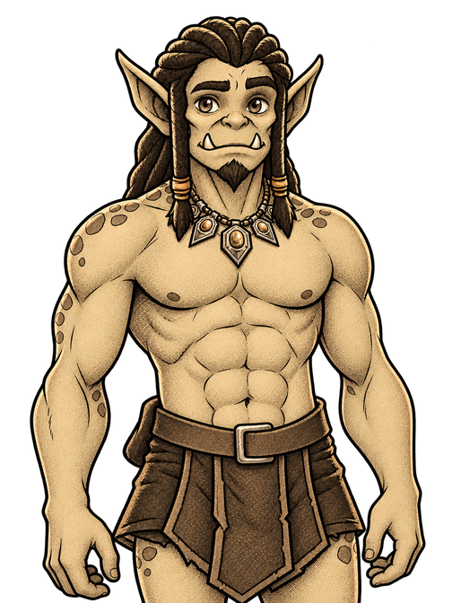
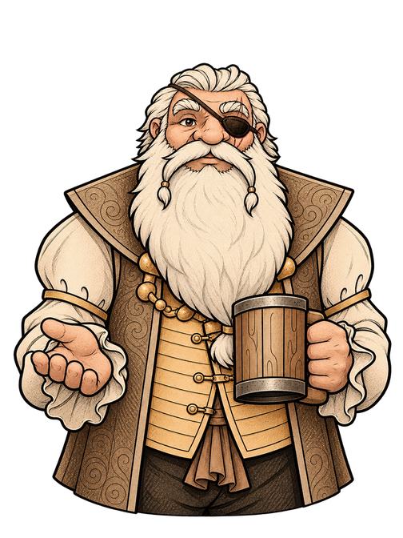
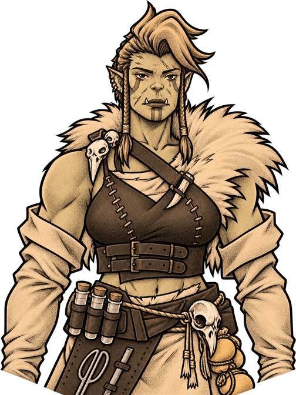

# DevLog #5 — The jam prototype is ready

We've reached the final version of the Terminus prototype for the jam. Ghork's campaign is playable through to the ending, starting with a seat at Story Night.

Rheed opens the game at the bandstand, where he tells the story of an orc who arrives in Terminus badly hurt. Ghork wants a future of his own, but first he needs to survive. Virmura saves his life, and his recovery starts with a small task: sorting bandages while sitting down.

Rheed at Story Night, where the campaign begins.

In our last post, we were still describing places through location sheets. Now you can visit them on the illustrated map. The guild halls, market and coliseum each have an entrance, and markers show where activities are available. When a quest takes you across town, the journal helps you find your destination.

Terminus after the opening quest, with activities marked on the map.

We've also brought character busts into the conversations. Below is an early exchange with Virmura during Ghork's recovery. These opening scenes give the two some time together before Ghork starts exploring the city.

Virmura's reply to Ghork's attempt at an introduction.

We've included the busts of Ghork, Rheed and Virmura for a closer look. The portraits share the scenery's sepia palette and ink lines. The artwork is still under review, even though this is the final prototype for the jam.

| Ghork | Rheed | Virmura |
| --- | --- | --- |
|  |  |  |

There are three guilds to choose from. That choice, along with the allies you recruit later, affects who you'll meet again. Companions are optional, so Ghork can also finish the story alone.

The prototype opens in English, with Portuguese available from the language selector. Progress saves in the browser, including your place in a conversation. You can close the game and return to the same passage later.
