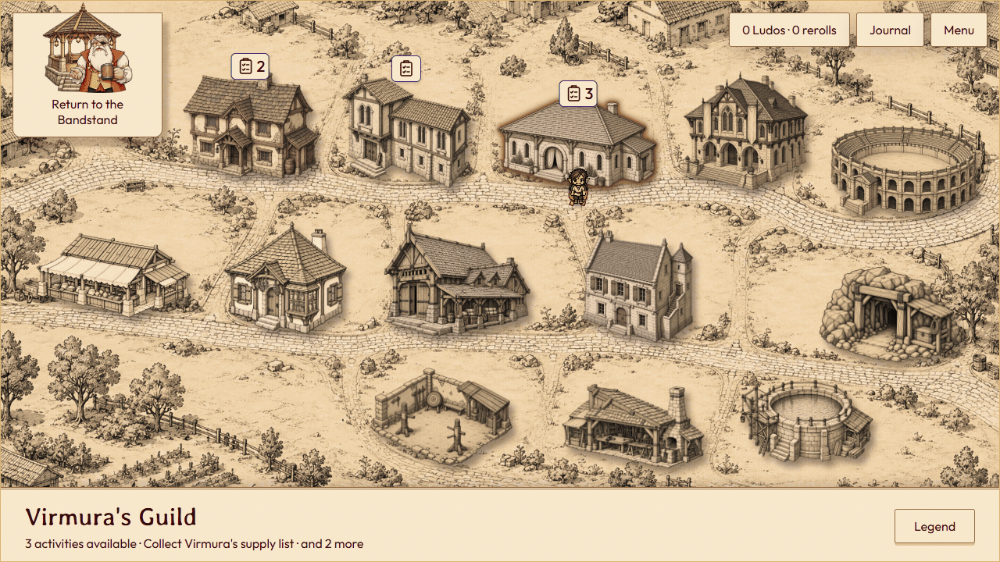
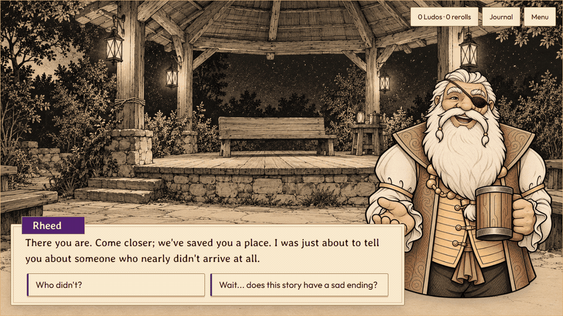
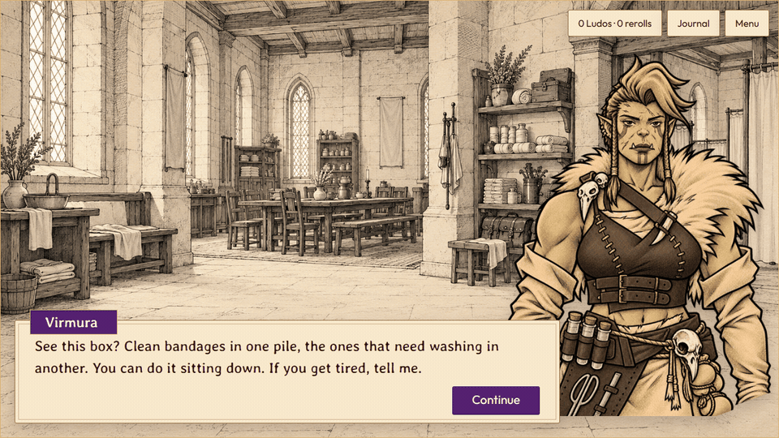
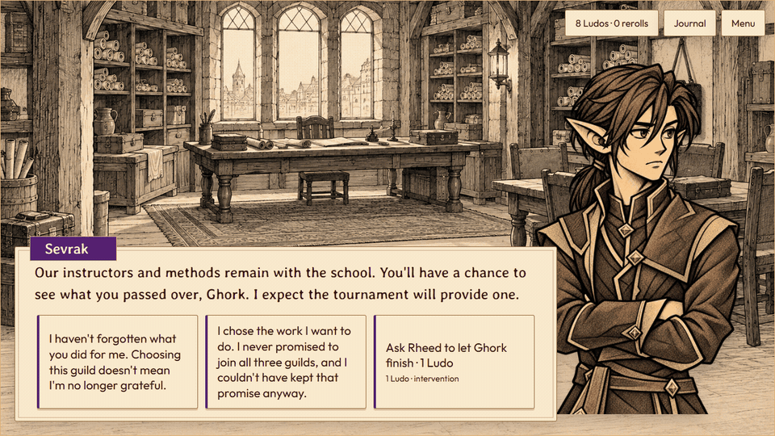

# DevLog #6 — Walking through Terminus

Our last post introduced the finished jam prototype through screenshots. This time, we've recorded a few moments in motion, starting with a walk across Terminus. Click a building on the map, and Ghork walks to its entrance. Here he's leaving Virmura's guild for the market. You can watch the whole trip or skip ahead.

The markers above buildings show where there's something to do. Once you arrive, the location offers its available activities. The journal can point you toward a quest's destination when you're unsure where to go next.

In conversations, lines appear gradually, with the speaking character beside the text. Click once to reveal the rest of a line, then again to continue. We've included reading-speed controls and an instant option if you'd rather see each line all at once.

Rheed makes room for you at Story Night before beginning Ghork's story. Later, Virmura gives Ghork bandages to sort while he recovers. She tells him to stay seated and speak up if he gets tired. He has a question of his own: can he stay there?

We've also recorded a Ludo intervention. When an argument leaves Ghork struggling to finish his explanation, you can spend one Ludo to interrupt Rheed. The child asks him to let Ghork finish. Rheed adds a meeting bell to the story, giving Ghork another chance to speak.

That payment belongs to the listener at the bandstand. It's a way to ask for a change in the telling, and Rheed has to find room for it. Free responses remain available, and the campaign can be completed without spending Ludos.
