# IDR-001 — Interface Coreto de Terminus

| Campo | Registro |
| --- | --- |
| Tipo | Interface Design Record — referência visual e decisões de interface |
| Data | 18/10/2026 |
| Status do projeto e do registro | Em desenvolvimento |
| Escopo | Interface implementada no projeto RPG Maker MZ Terminus |
| Origem | Pedidos de design do autor e confirmação manual da correção de contraste nesta conversa |
| Referência visual | Guia Coreto 1.1, pacote 1.2.1, revisão `coreto-approved-2026-10-17-r2` |
| Ambiente das capturas | NW.js 0.48.4 / Chromium 85, canvas de 1280 × 720 px |
| Substitui | Nenhum registro anterior |

## 1. Objetivo e limites

Este IDR documenta a aparência atual da interface e as decisões que devem orientar sua manutenção. Serve ao autor, ao design e à implementação para comparar mudanças futuras com uma referência identificável.

A confirmação do autor encerra a correção de contraste das opções. Ela não equivale à aprovação definitiva de todas as telas fotografadas. O jogo e este registro permanecem **em desenvolvimento**.

As 18 imagens são capturas do jogo em execução, sem redesenho ou retoque. Foram produzidas em uma sessão nativa isolada que lê os plugins, recursos e configurações atuais. Personagens, inventário, moeda, habilidades, loja, slot de salvamento, diálogo e batalha usam dados de demonstração. Não definem elenco, economia, narrativa ou mecânicas finais de Terminus. Os saves do autor e os parâmetros do projeto foram preservados.

O registro cobre título, opções e seus estados, remapeamento, menu interno, itens, equipamento, habilidades, status, loja, salvamento, diálogo e batalha. Não constitui um inventário de todas as telas possíveis dos plugins, nem validação completa de acessibilidade, animações ou responsividade.

## 2. Contexto da decisão

O menu de opções apresentava peso visual maior que o menu interno: linhas inteiras em roxo, texto creme, contornos em todas as alternativas e pictogramas maiores. Também ocorreram acúmulo de hover, fundos opacos nos ícones e regressão de contraste ao gravar parâmetros antigos pelo editor.

A decisão adotada foi aproximar as opções do menu interno: superfícies claras, tinta escura, seleção lavanda, contornos discretos e destaque reservado ao valor ativo. O design usa os tokens Coreto existentes e preserva a responsabilidade de cada plugin.

## 3. Decisões registradas

### D1 — Identidade do título

Usar a arte de entrada fornecida pelo autor, com o nome do jogo desenhado em texto pelo CoreEngine. Cinzel Decorative em roxo recebe uma segunda impressão dourada deslocada, produzindo relevo. O banner fornecido anteriormente permanece apenas como referência; não é um recurso da tela de título.

O título conserva comandos com seleção roxa e texto creme. A mudança para seleção clara foi aplicada às opções e às superfícies do menu interno, sem uniformizar todas as telas à força.

### D2 — Superfície e hierarquia das opções

Usar papel como superfície principal e tinta para leitura. Categorias, linhas e remapeamento recebem lavanda quando selecionados. O valor ativo possui uma marca de confirmação e superfície própria; alternativas inativas não possuem caixas adicionais.

Preservar as áreas de interação, os handlers, a navegação por teclado e a persistência do OptionsCore. Seções organizam o conteúdo e não entram na navegação. Indisponibilidade deve ter uma explicação legível quando existir dependência de outra preferência.

### D3 — Hover separado de seleção

O ponteiro pode destacar uma linha sem alterar a seleção quando a preferência de seleção por hover está desligada. Nesse caso, duas linhas podem ter fundo lavanda, mas seus contornos têm significados distintos: dourado para seleção, roxo para hover.

O item anterior perde o hover quando o ponteiro muda de linha. Somente as linhas afetadas são redesenhadas. Não se usa repintura contínua da janela nem atraso artificial.

### D4 — Contraste coerente com o fundo

Nas opções claras, rótulos e pictogramas permanecem em tinta; valores ativos usam roxo. Creme fica reservado aos tratamentos de superfície escura que o utilizam. A regra antiga que tornava todo texto selecionado creme não pertence à receita atual das opções.

A última verificação registrada mediu 13,67:1 para tinta sobre lavanda e pelo menos 9,02:1 nos textos de controles/categorias exercitados. Esses resultados pertencem aos estados testados das opções; não certificam as demais telas.

### D5 — Pictogramas sem placas opacas

Usar pictogramas correspondentes à função de cada comando. As categorias e linhas das opções têm fundo transparente e desenho na escala de 24 px. O atlas mantém as células originais 0–319, incluindo os ícones nativos ainda usados pelo banco de dados.

As 77 opções configuradas possuem associações explícitas de ícone; nenhuma usa o ícone de ajustes como substituto genérico. A quantidade visível varia conforme plugins, categorias e condições de disponibilidade.

### D6 — Prioridade dos provedores

Configurar cada propriedade no plugin que a oferece. Os seis `VisuMZ_1_*` precedem o DesignSystem e mantêm fontes originais, sem edição. O DesignSystem complementa lacunas de apresentação; não deve substituir layouts, cores semânticas, fontes, opacidade ou callbacks oferecidos por esses provedores.

As opções pertencem ao **Coreto_1_OptionsCore**. Nenhum dos seis VisuMZ instalados substitui seu desenho de controles ou oferece o destaque de hover das linhas das opções. O `MouseCursor` do MainMenuCore controla a imagem do ponteiro, não a seleção de uma linha.

### D7 — Editor e parâmetros precisam concordar

Antes de gerar parâmetros externamente, confirmar o encerramento do editor e do playtest pela interface do Windows. Reabrir o projeto depois da geração, salvar pelo editor e testar por ele. A sessão anterior mostrou que uma consulta de processos no terminal restrito podia omitir o editor ainda aberto, que mantinha parâmetros antigos em memória.

## 4. Referência visual

### Paleta

| Papel visual | Token / cor |
| --- | --- |
| Papel das janelas | `panel` — `#f9eacf` |
| Tinta principal | `Ink` — `#360a0b` |
| Roxo principal e valores ativos | `primary` — `#552070` |
| Seleção e hover claros | `hover` — `#eedff2` |
| Contorno de seleção / relevo do título | `gold` — `#edaa2f` |
| Contorno de hover | `focus` — `#8224ad` |
| Contorno pressionado | `primary` — `#552070` |
| Contorno comum | `border` — `#704737` |
| Contorno sutil do valor ativo | `subtle` — `#be9a6b` |
| Superfície indisponível / trilho | `disabled` — `#d3c7b4` |
| Texto sobre superfícies escuras | `onAccent` — `#fff8eb` |

### Tipografia e dimensões

| Elemento | Especificação atual |
| --- | --- |
| Nome do jogo | Cinzel Decorative, 52 px, linha 56 px, negrito sintetizado; dourado deslocado 2 px à direita e 3 px abaixo |
| Seções das opções | Averia Libre, 32 px, linha 40 px |
| Rótulos das opções | Outfit Medium, 22 px, linha 28 px |
| Alternativas / ações | Outfit Medium, 20 px, linha 24 px |
| Explicações de indisponibilidade | Outfit Medium, 16 px, linha 20 px |
| Pictogramas das opções | Desenho de 24 px; células do atlas de 32 px |
| Linha de opção | Passo de 76 px, com espaçamento configurado de 12 px |
| Controles internos | Área de clique com altura de 44 px |
| Barras | Trilho de 8 px; indicador de 10 × 18 px |
| Contornos | 1 px comum; 2 px em foco/hover |
| Raios | 6 px nos controles; 10 px nos painéis da receita |

Os provedores específicos podem possuir dimensões próprias, como custos e indicadores em 16 px. A tabela não impõe o tamanho dos rótulos de opções a todas as telas.

### Estados das opções

| Estado | Tratamento |
| --- | --- |
| Padrão | Papel, tinta e contorno fino |
| Selecionado | Lavanda, tinta e contorno dourado |
| Hover sem seleção | Lavanda, tinta e contorno roxo |
| Selecionado + hover | Lavanda, tinta e contorno dourado |
| Pressionado | Superfície clara com contorno roxo escuro |
| Valor ativo | Marca em roxo; papel sobre linha destacada, lavanda sobre linha padrão |
| Indisponível | Superfície neutra e explicação em tinta |

## 5. Responsabilidade por tela

| Área | Responsável principal |
| --- | --- |
| Título, paleta global e valores compartilhados | Coreto_0_CoreEngine |
| Categorias e conteúdo de status | VisuMZ_1_ElementStatusCore |
| Batalha e opções próprias de batalha | VisuMZ_1_BattleCore |
| Rótulos e ícones de eventos | VisuMZ_1_EventsMoveCore |
| Itens, equipamento e loja | VisuMZ_1_ItemsEquipsCore |
| Organização e comandos do menu interno | VisuMZ_1_MainMenuCore |
| Habilidades, custos, estados e indicadores | VisuMZ_1_SkillsStatesCore |
| Diálogo e fontes registradas | Coreto_1_MessageCore / Coreto_2_ExtMessageFunc |
| Categorias, controles, remapeamento e persistência das opções | Coreto_1_OptionsCore |
| Salvamento e seus cartões | Coreto_1_SaveCore |
| Acabamentos comuns e estados sem configuração equivalente | Coreto_5_DesignSystem |

O status de batalha usa `BattleLayout/StatusWindowSkinFilename = CoretoWindow`. Moldura, fundo e cursor dessa janela são responsabilidade do BattleCore; ela está excluída da decoração do DesignSystem. A ordem completa e os hashes dos plugins estão no [manifesto desta captura](assets/IDR-001/manifest.json). A [matriz detalhada](../interface-coreto.md#responsabilidade-por-propriedade) explica os campos de configuração.

## 6. Galeria do estado atual

As imagens abaixo são PNGs de 1280 × 720 px. Abra o arquivo para consultar a resolução original. O cursor do sistema operacional não faz parte do bitmap capturado; o estado de hover aparece no fundo e no contorno.

### 01 — Título

Arte fornecida pelo autor, nome desenhado em texto e comandos centrais.

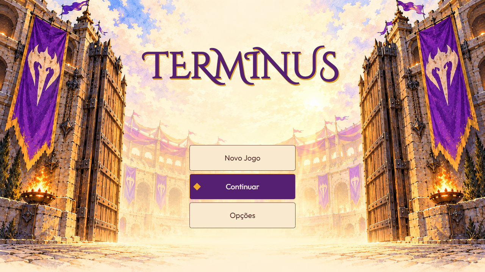

### 02 — Opções: Geral

Seleção clara, valor ativo marcado e títulos de seção separados das ações.

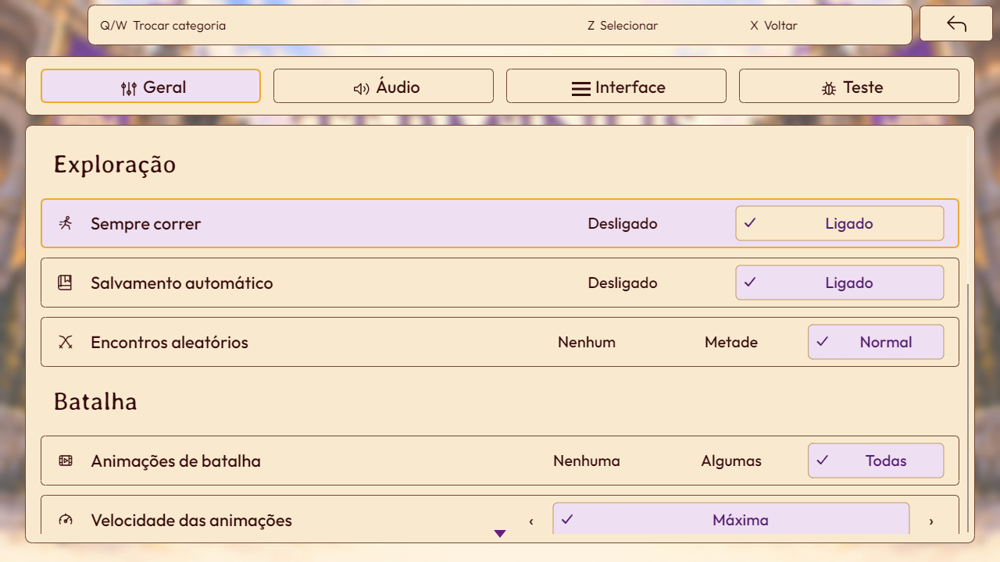

### 03 — Opções: seleção e hover separados

“Sempre correr” está selecionado; “Salvamento automático” recebe hover. A seleção por ponteiro foi desligada apenas na sessão de captura para demonstrar essa distinção.

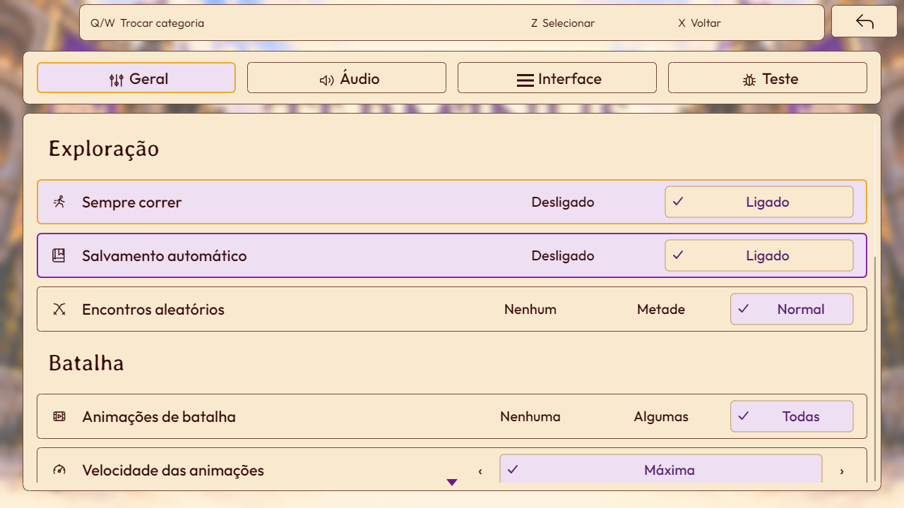

### 04 — Opções: Áudio

Trilhos neutros, preenchimento roxo e valores alinhados à direita.

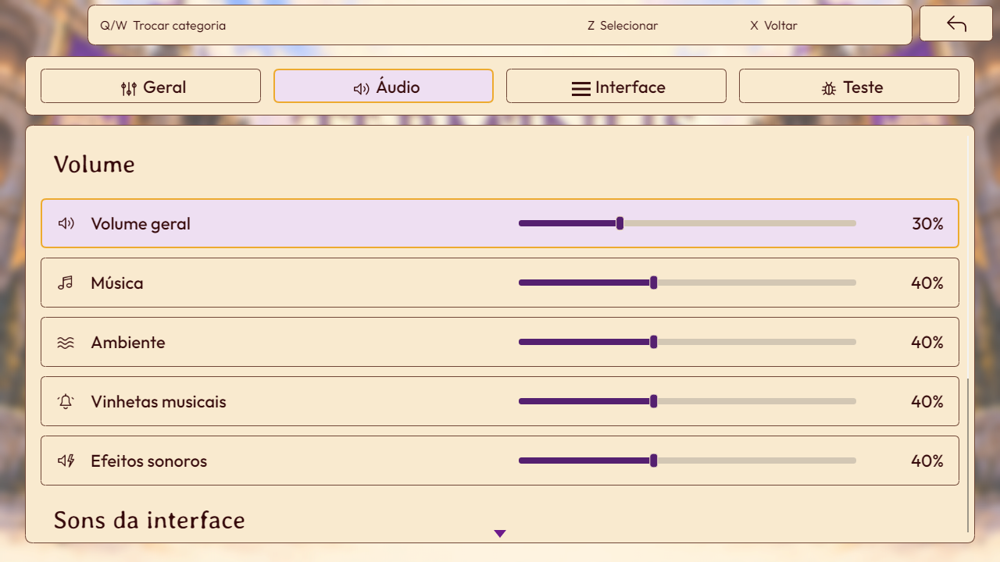

### 05 — Opções: Interface

Controles de janela e início das preferências de texto.

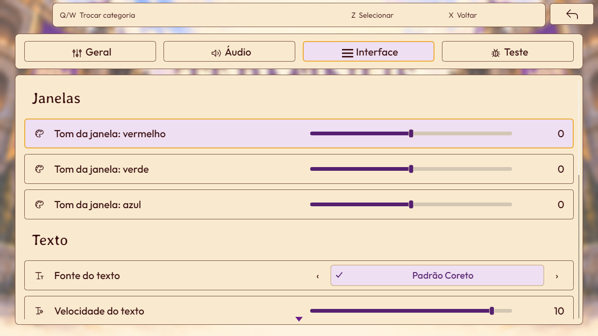

### 06 — Opções: organização e indisponibilidade

Dependências são explicadas na própria linha, preservando a leitura.

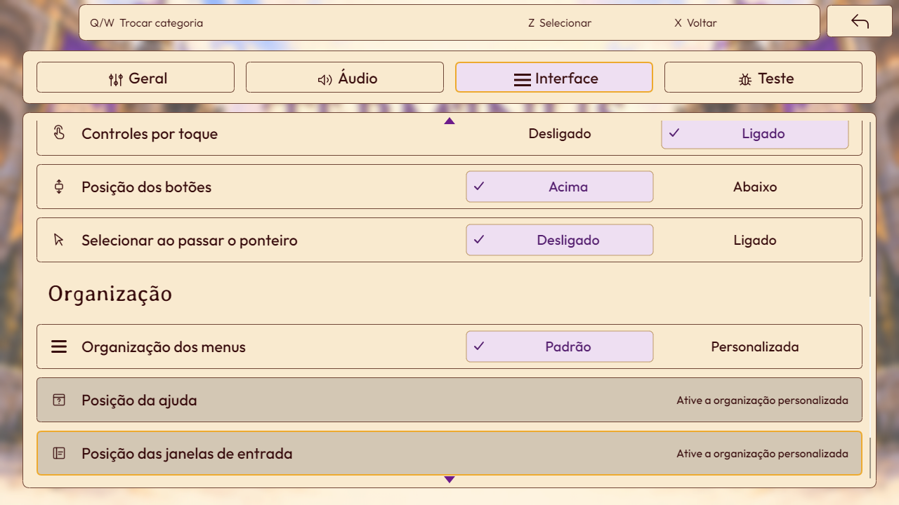

### 07 — Opções: Teste

Estado atual com ferramentas de teste desligadas; ações condicionais não aparecem.

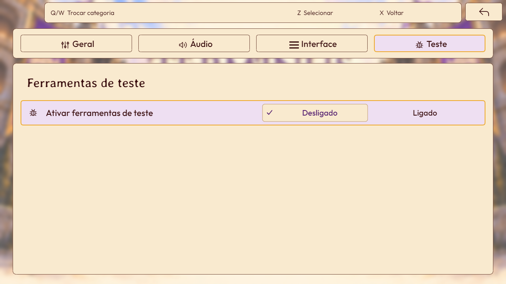

### 08 — Remapeamento de teclado

Colunas de ação, tecla fixa e alternativa, com seleção lavanda.

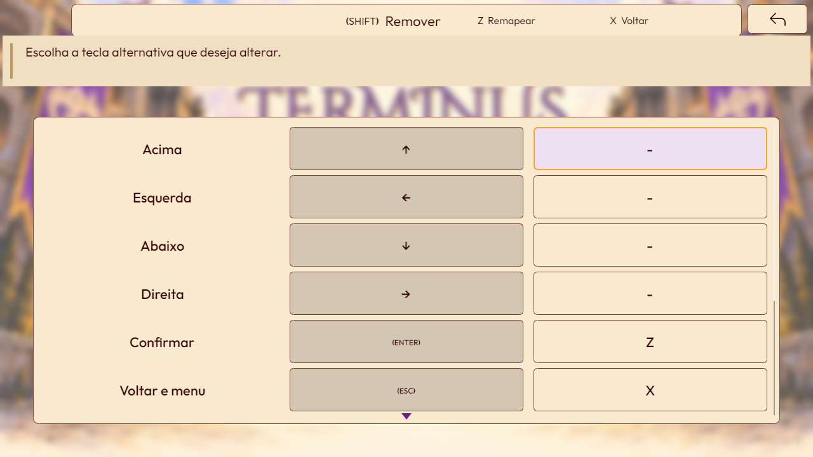

### 09 — Remapeamento de controle

Lista de comandos e botões; captura sem interação com dispositivo físico.

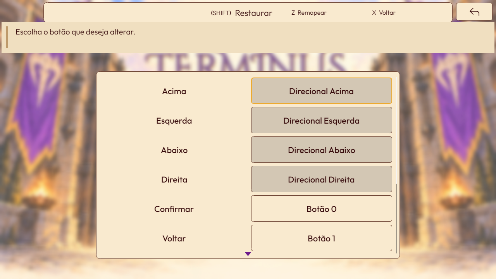

### 10 — Menu interno

Comandos em grade, cartões dos aliados, barras de recursos, tempo e moeda. Elenco e valores são de demonstração.

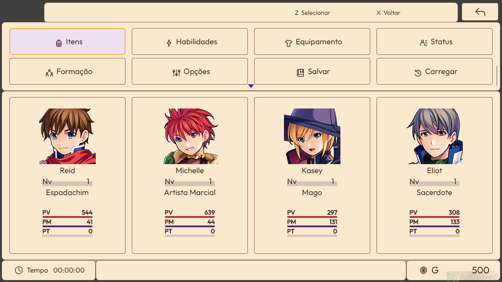

### 11 — Itens

Categorias pictográficas, lista e painel de informações. Ícones nativos de itens continuam presentes.

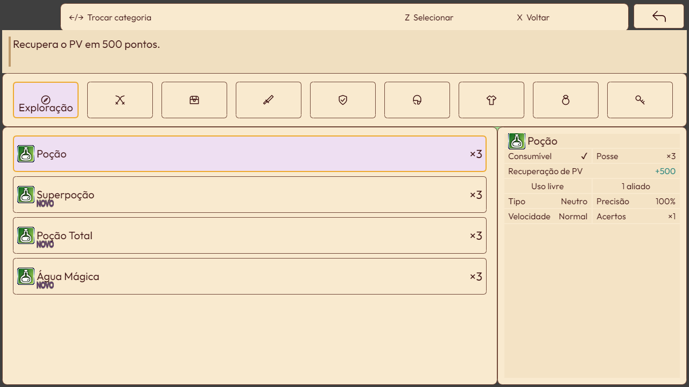

### 12 — Equipamento

Atributos e personagem à esquerda; ações e slots à direita.

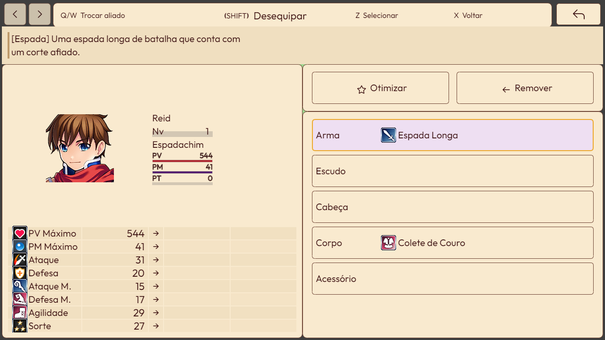

### 13 — Habilidades

Categoria, recursos, habilidade e painel de informações. A disponibilidade segue as regras atuais do provedor.

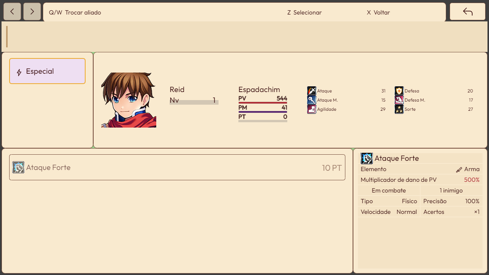

### 14 — Status

Categorias horizontais e ficha do personagem de demonstração. A biografia está vazia no banco atual.

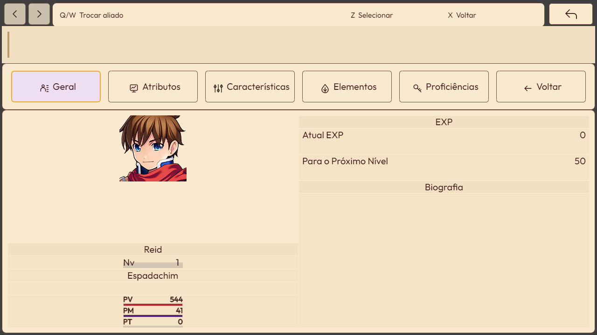

### 15 — Loja

Lista de compra com um item de demonstração. Nenhuma transação foi realizada para a captura.

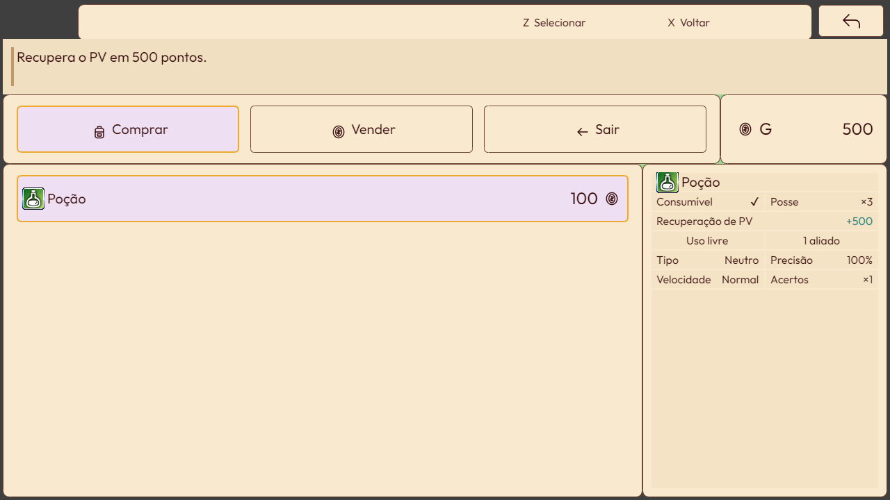

### 16 — Salvamento

Cartões de slots, retratos, data e duração. O slot foi criado somente no armazenamento isolado. A seleção desta tela ainda usa roxo e creme.

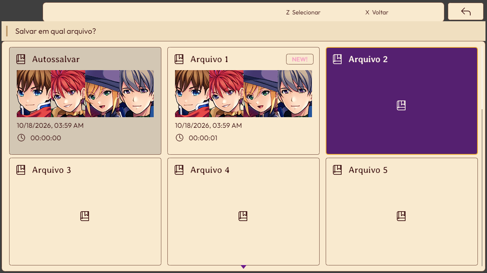

### 17 — Diálogo

Mensagem técnica de demonstração, sem conteúdo narrativo aprovado. Registra também o nome do interlocutor e a barra de comandos como estão implementados.

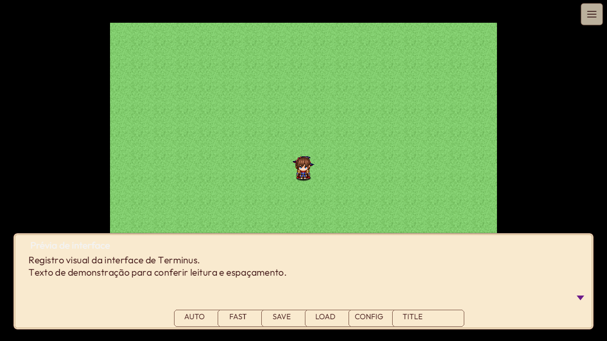

### 18 — Batalha

Primeira tropa do banco atual, com cenário e inimigos de demonstração. Registra o painel dos aliados e a janela de comandos após sua abertura.

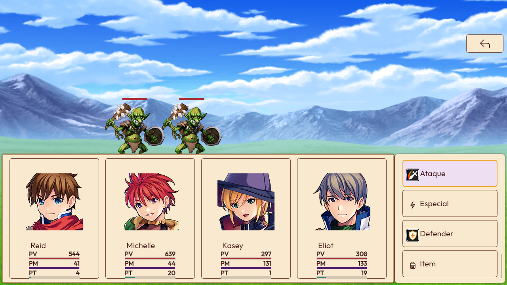

## 7. Observações do retrato atual

Estas observações preservam o estado encontrado; não representam novas decisões de design nem correções executadas neste pedido.

- O título e o salvamento mantêm seleção escura, enquanto opções e menu interno usam seleção clara.
- Há ícones nativos coloridos nos dados de itens, atributos e habilidades. A substituição dos pictogramas das opções não foi uma substituição integral do atlas do jogo.
- No diálogo, o nome do interlocutor aparece claro sobre papel e os comandos inferiores permanecem em inglês (`AUTO`, `FAST`, `SAVE`, `LOAD`, `CONFIG`, `TITLE`). Essa tela não está coberta pela aprovação do contraste das opções.
- No salvamento, o indicador `NEW!` e o formato de data/hora ainda seguem o tratamento atual do provedor.
- A batalha combina pictogramas nativos e Coreto; sua captura registra a disposição atual dos cartões e comandos, sem afirmar que o acabamento de todas as etapas de combate esteja concluído.

## 8. Evidências e manutenção

O [manifesto de captura](assets/IDR-001/manifest.json) registra horário, ambiente, ordem e hashes dos plugins, hash dos parâmetros e SHA-256 de cada PNG. A captura não registrou erros JavaScript e confirmou a preservação dos parâmetros e dos saves do autor. Isso atesta a execução desta coleta, não a ausência de defeitos visuais em todo o jogo.

O arquivo `plugins.js` desta referência possui SHA-256 `fdebf0c03aabf11b04f6695a355d8f506f1ca3ae3e5526958f35a9e257693a21`.

As decisões anteriores e suas verificações estão em [Interface Coreto](../interface-coreto.md) e no [histórico de ajustes](../historico-ajustes-design.md). A coleta foi feita por [capture-idr.mjs](../../../tools/terminus-ui/capture-idr.mjs), usando o runtime nativo e armazenamento isolado. O script recusa sobrescrever um registro que já possui manifesto.

Para uma revisão visual futura, criar um novo IDR e uma nova pasta de capturas, indicando quais decisões deste documento foram mantidas ou substituídas. Não substituir estas imagens por uma aparência posterior: elas são a referência datada do IDR-001.

## 9. Histórico do registro

| Data | Alteração |
| --- | --- |
| 18/10/2026 | Primeiro IDR: decisões consolidadas, 18 capturas nativas e observações do estado implementado após a confirmação manual das opções pelo autor. |
